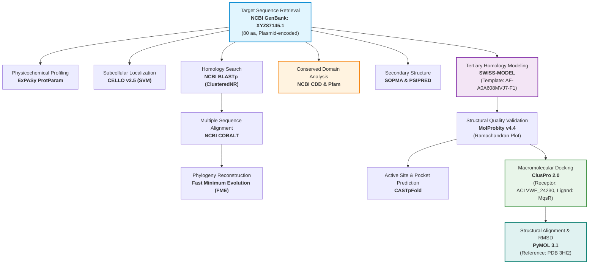
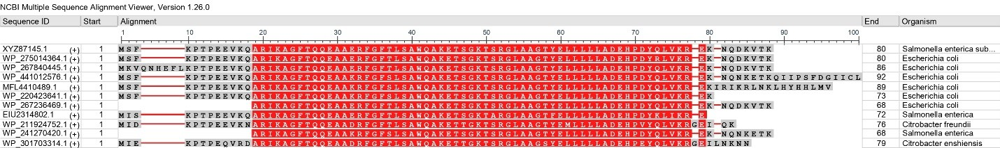
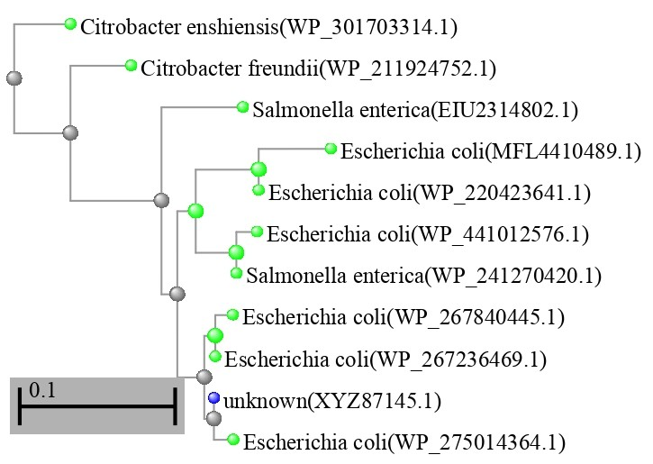
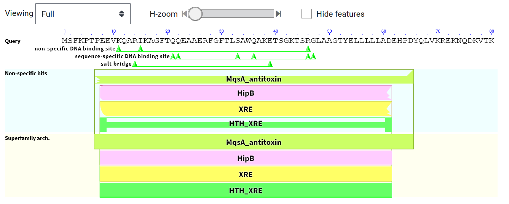
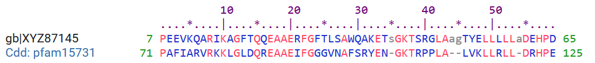
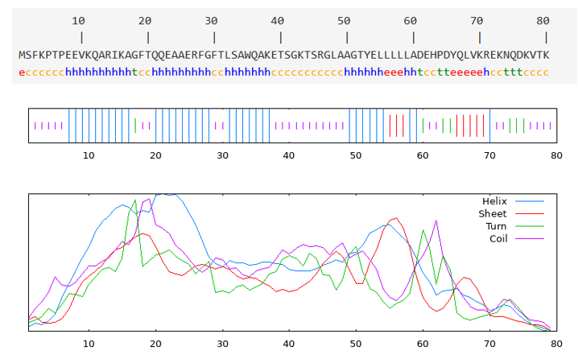
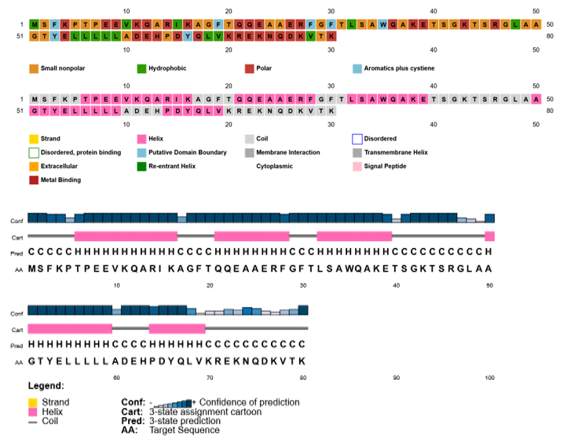
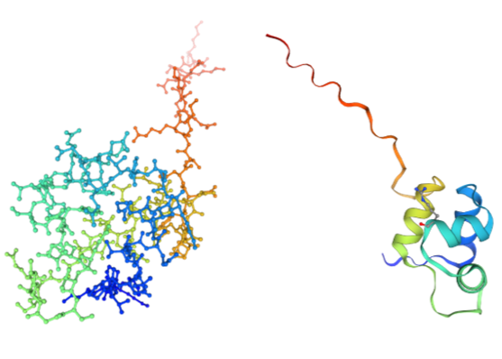
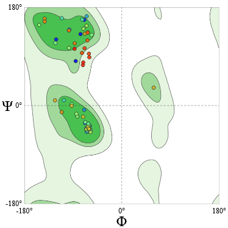

# *In Silico* Structural and Functional Annotation of Hypothetical Protein ACLVWE_24230 from *Salmonella enterica* Serovar Typhi Plasmid: An MqsA-Family Antitoxin and HTH Transcriptional Regulator

**Md Abu Sadat Soash**  
Department of Genetic Engineering and Biotechnology  
Shahjalal University of Science and Technology, Sylhet, Bangladesh  

[](https://github.com/Soash/salmonella-mqsa-annotation)
[](https://www.ncbi.nlm.nih.gov/datasets/taxonomy/90370/)
[](https://www.ncbi.nlm.nih.gov/protein/XYZ87145.1)
[-purple)](https://www.ebi.ac.uk/interpro/entry/pfam/PF15731/)

---

## Abstract

*Salmonella enterica* subsp. *enterica* serovar Typhi is the causative agent of typhoid fever, an invasive systemic disease posing substantial global healthcare challenges. Plasmids within *S. enterica* frequently harbor genes of unknown biological significance ("hypothetical proteins") that may drive plasmid maintenance, virulence, stress resilience, or antibiotic tolerance. In this research, an extensive, multi-tier *in silico* workflow was deployed to structurally and functionally annotate the uncharacterized hypothetical protein **ACLVWE_24230** (GenBank: `XYZ87145.1`), encoded on a plasmid of *S. enterica* serovar Typhi.

Physicochemical profiling characterized ACLVWE_24230 as an 80-amino-acid, basic (theoretical $\text{pI} = 9.00$), hydrophilic ($\text{GRAVY} = -0.761$), and highly stable ($\text{Instability Index} = 21.18$) cytoplasmic protein with a molecular weight of 9.015 kDa. Conserved Domain Database (CDD) and Pfam analyses revealed the presence of a definitive **MqsA-family antitoxin domain** (`pfam15731`, E-value: $3.84 \times 10^{-5}$) harboring a conserved **Helix-Turn-Helix (HTH_XRE)** DNA-binding motif (`cd00093`). High-confidence 3D homology modeling using the AlphaFold-predicted template of YajA from *Salmonella thompson* achieved full-length sequence coverage with a Global Model Quality Estimation (GMQE) score of 0.90. Stereochemical validation via MolProbity yielded a MolProbity score of 0.92, zero clash score, and 93.59% residues in favored Ramachandran regions. Cavity analysis identified a major functional surface pocket ($\text{Area} = 134.88\ \text{Å}^2$, $\text{Volume} = 250.55\ \text{Å}^3$) clustering within the HTH motif. Molecular docking against toxin **MqsR** (from PDB: 3HI2) via ClusPro demonstrated high-affinity interaction (Cluster 0 weighted score: $-720.3\ \text{kcal/mol}$) with an interface backbone $\text{RMSD} = 0.075\ \text{Å}$ relative to experimental *E. coli* MqsA-MqsR complexes. These findings demonstrate that ACLVWE_24230 functions as an MqsA-family antitoxin and HTH transcriptional regulator, providing insights into plasmid stability and bacterial persistence in typhoid fever.

---

## Table of Contents

- [Abstract](#abstract)
- [Workflow Architecture](#workflow-architecture)
- [Target Sequence Information](#target-sequence-information)
- [Methodology & Tools](#methodology--tools)
- [Key Findings & Results](#key-findings--results)
  - [1. Physicochemical Characterization](#1-physicochemical-characterization)
  - [2. Subcellular Localization](#2-subcellular-localization)
  - [3. Homology & Phylogenetic Analysis](#3-homology--phylogenetic-analysis)
  - [4. Conserved Domain & Functional Annotation](#4-conserved-domain--functional-annotation)
  - [5. Secondary Structure Analysis](#5-secondary-structure-analysis)
  - [6. 3D Homology Modeling & Quality Validation](#6-3d-homology-modeling--quality-validation)
  - [7. Pocket & Binding Cavity Analysis](#7-pocket--binding-cavity-analysis)
  - [8. Protein–Protein Docking with MqsR Toxin](#8-proteinprotein-docking-with-mqsr-toxin)
- [Visual Gallery](#visual-gallery)
- [Repository Organization](#repository-organization)
- [Reproduction & Inspection Guide](#reproduction--inspection-guide)
- [References & Data Sources](#references--data-sources)

---

## Workflow Architecture

The computational pipeline integrates sequence retrieval, physicochemical computation, evolutionary analysis, structural modeling, stereochemical validation, active pocket mapping, and macromolecular docking:



---

## Target Sequence Information

- **Locus Tag:** `ACLVWE_24230`
- **GenBank Accession:** `XYZ87145.1`
- **Host Organism:** *Salmonella enterica* subsp. *enterica* serovar Typhi
- **Genetic Context:** Plasmid-borne
- **Length:** 80 amino acids
- **Primary Sequence (FASTA):**
  ```fasta
  >XYZ87145.1 hypothetical protein ACLVWE_24230 (plasmid) [Salmonella enterica subsp. enterica serovar Typhi]
  MSFKPTPEEVKQARIKAGFTQQEAAERFGFTLSAWQAKETSGKTSRGLAAGTYELLLLLA
  DEHPDYQLVKREKNQDKVTK
  ```

---

## Methodology & Tools

| Investigation Step | Tool / Server | Database / Reference | Key Parameters |
|---|---|---|---|
| **Sequence Retrieval** | NCBI GenBank | NCBI Entrez Protein | Accession: `XYZ87145.1` |
| **Physicochemical Analysis** | ExPASy ProtParam | Swiss Institute of Bioinformatics | Default pKa values |
| **Subcellular Localization** | CELLO v2.5 | Subcellular Localization Server | SVM multi-feature composition |
| **Homology Search** | NCBI BLASTp | ClusteredNR | E-value cutoff $\le 10^{-5}$ |
| **Multiple Sequence Alignment**| NCBI COBALT | NCBI Protein Clusters | Pairwise & constraint alignment |
| **Phylogenetic Analysis** | Fast Minimum Evolution | Grishin Distance Model | Max difference: 0.85 |
| **Conserved Domain Search** | NCBI CD-Search | CDD v3.21 / Pfam | E-value cutoff: 0.01 |
| **Secondary Structure** | SOPMA & PSIPRED | UCL Bioinformatics Group | Window: 17, threshold: 8 |
| **3D Structure Prediction** | SWISS-MODEL | AlphaFold Template Library | Template: A0A608MVJ7.1.A (YajA) |
| **Stereochemical Validation** | MolProbity v4.4 | Duke University | All-atom contacts, Ramachandran |
| **Pocket & Cavity Mapping** | CASTpFold | UIC Bioinformatics | Probe radius: 1.4 Å |
| **Protein-Protein Docking** | ClusPro 2.0 | Boston University / Stony Brook | PIPER rigid-body, pairwise clusters |
| **Molecular Visualization** | PyMOL 3.1 | Schrödinger, LLC | RMSD, cartoon rendering |

---

## Key Findings & Results

### 1. Physicochemical Characterization

ProtParam analysis demonstrated that ACLVWE_24230 is a small, basic, hydrophilic, and thermodynamically stable protein.

| Parameter | Value | Interpretation |
|---|---|---|
| **Sequence Length** | 80 aa | Low molecular mass |
| **Molecular Weight** | 9,015.21 Da (~9.02 kDa) | Typical single-domain regulator |
| **Theoretical Isoelectric Point ($\text{pI}$)** | 9.00 | Basic protein (facilitates DNA interaction) |
| **Total Charged Residues** | $+13$ (Arg + Lys), $-11$ (Asp + Glu) | Net positive charge ($+2$) at physiological pH |
| **Instability Index (II)** | 21.18 | **Highly Stable** (value $< 40$ denotes stability) |
| **Aliphatic Index** | 66.00 | Moderate thermostability |
| **Grand Average of Hydropathicity (GRAVY)** | $-0.761$ | **Hydrophilic** (favorable aqueous solubility) |
| **Extinction Coefficient** | $8,480\ \text{M}^{-1}\text{cm}^{-1}$ | Abs 0.1% ($= 1\ \text{g/L}$) = 0.941 |
| **Estimated Half-Life** | 30 h (mammalian reticulocytes)<br/>$>20$ h (yeast)<br/>$>10$ h (*E. coli*) | Robust in vivo stability |

### 2. Subcellular Localization

CELLO v2.5 SVM scores predicted ACLVWE_24230 to reside in the **cytoplasm**, consistent with transcriptional regulators and antitoxin components:

| Compartment | CELLO SVM Score |
|---|---|
| **Cytoplasm** | **2.453 (Predominant)** |
| **Periplasmic** | 1.341 |
| **Extracellular** | 0.632 |
| **Outer Membrane** | 0.322 |
| **Inner Membrane** | 0.252 |

### 3. Homology & Phylogenetic Analysis

NCBI BLASTp against ClusteredNR indicated high sequence similarity with uncharacterized and MqsA-like proteins across the Enterobacteriaceae family:
- Top hits include *Escherichia coli* and *Salmonella enterica* homologs sharing **93.5% – 98.8% sequence identity** with 96% – 100% query coverage ($E$-values: $10^{-50}$ to $10^{-44}$).
- Fast Minimum Evolution (FME) tree clustering placed ACLVWE_24230 with enteric MqsA antitoxin sequences, confirming strict evolutionary conservation within the plasmid-borne Toxin-Antitoxin module.

### 4. Conserved Domain & Functional Annotation

NCBI CD-Search revealed critical regulatory and antitoxin domains:

| Domain Name | Accession / Source | Interval (aa) | E-value | Functional Implication |
|---|---|---|---|---|
| **MqsA_antitoxin** | `pfam15731` | 7 – 65 | $3.84 \times 10^{-5}$ | Type II Toxin-Antitoxin system antitoxin component |
| **HipB** | `COG1396` | 8 – 61 | $2.73 \times 10^{-3}$ | TA system repressor / transcriptional regulator |
| **XRE** | `COG1476` | 8 – 61 | $3.51 \times 10^{-3}$ | Xenobiotic Response Element DNA-binding regulator |
| **HTH_XRE** | `cd00093` | 8 – 61 | $9.67 \times 10^{-3}$ | Helix-Turn-Helix transcriptional regulation motif |

> The coexistence of the **MqsA_antitoxin** domain and the **HTH_XRE** DNA-binding motif confirms that ACLVWE_24230 plays a dual role: neutralizing cognate toxin MqsR and autoregulating the operon via promoter DNA-binding.

### 5. Secondary Structure Analysis

SOPMA and PSIPRED secondary structure predictions revealed an alpha-helix-dominated architecture characteristic of prokaryotic DNA-binding proteins:

| Secondary Structure Element | Residues | Percentage |
|---|---|---|
| **Alpha Helix ($\alpha$)** | 35 | **43.75%** |
| **Random Coil (c)** | 29 | **36.25%** |
| **Extended Strand ($\beta$)** | 9 | **11.25%** |
| **Beta Turn (t)** | 7 | **8.75%** |

### 6. 3D Homology Modeling & Quality Validation

Homology modeling via SWISS-MODEL utilized the AlphaFold-predicted structure of YajA from *Salmonella thompson* (UniProt: `A0A608MVJ7.1.A`):
- **Coverage:** 100% (residues 1–80)
- **Sequence Identity:** 100%
- **GMQE Score:** 0.90 (indicating exceptionally high fidelity)

Stereochemical validation via MolProbity v4.4 confirmed outstanding structural quality:
- **MolProbity Score:** **0.92** (100th percentile; scores $<2.0$ indicate high experimental-grade quality)
- **Clash Score:** **0.00** (zero atomic clashes)
- **Ramachandran Favored:** **93.59%**
- **Ramachandran Outliers:** 2.56% (only Asn74 and Asp76 in the C-terminal flexible loop)
- **Rotamer Outliers:** **0.00%**
- **Covalent Geometry:** 0 / 647 bad bonds; 2 / 869 bad angles (negligible, localized at Thr79–Lys80)

### 7. Pocket & Binding Cavity Analysis

CASTpFold topographically mapped nine surface pockets (POC 1–9):

| Pocket ID | Lining Residues (cnr) | Area ($\text{Å}^2$) | Volume ($\text{Å}^3$) | Pocket Length ($\text{Å}$) | Biological Significance |
|---|---|---|---|---|---|
| **POC 1** | **29** | **134.88** | **250.55** | **71.57** | **Dominant functional binding cavity overlapping HTH DNA-binding residues** |
| **POC 2** | 3 | 24.08 | 49.38 | 9.19 | Minor surface cleft |
| **POC 3** | 21 | 65.37 | 84.27 | 32.14 | Secondary shallow pocket |
| **POC 4** | 22 | 103.68 | 79.18 | 36.82 | Secondary shallow pocket |
| **POC 5–9** | $\le 10$ | $\le 36.93$ | $\le 23.71$ | $\le 9.81$ | Transient cavities |

The residues lining **POC 1** directly map to the HTH_XRE motif, confirming its function as the operator DNA-binding interface.

### 8. Protein–Protein Docking with MqsR Toxin

Rigid-body protein–protein docking performed using ClusPro 2.0 (Receptor: modeled ACLVWE_24230; Ligand: MqsR from PDB: `3HI2`):
- ClusPro identified 25 conformational clusters.
- **Cluster 0** was the dominant ensemble with **252 members**, displaying a center weighted score of **$-720.3\ \text{kcal/mol}$** and lowest energy score of **$-833.4\ \text{kcal/mol}$**.
- Structural superposition with the crystallographic *E. coli* MqsA-MqsR complex (PDB: `3HI2`) yielded an $\text{RMSD} = \mathbf{0.075\ \text{Å}}$ across the antitoxin domain, verifying the conservation of the binding interface.

---

## Visual Gallery

The project figures illustrate each stage of the analysis:

| Fig | Description | Preview |
|:---:|---|:---:|
| **1** | **Multiple Sequence Alignment (COBALT)**<br/>Conservation of functional residues across *Salmonella*, *E. coli*, and *Citrobacter* homologs. | [](fig/1.jpg) |
| **2** | **Phylogenetic Tree (Fast Minimum Evolution)**<br/>Evolutionary relationship and clustering of ACLVWE_24230 within enteric MqsA proteins. | [](fig/2.jpg) |
| **3** | **Conserved Domain Architecture (NCBI CDD)**<br/>Identification of the MqsA_antitoxin (`pfam15731`) and HTH_XRE (`cd00093`) domains. | [](fig/3.png) |
| **4** | **Pfam Domain Alignment**<br/>Pairwise alignment of ACLVWE_24230 against Pfam reference profile `pfam15731`. | [](fig/4.png) |
| **5** | **SOPMA Secondary Structure Prediction**<br/>Relative distribution of $\alpha$-helices (43.75%), random coils (36.25%), and $\beta$-strands (11.25%). | [](fig/5.png) |
| **6** | **PSIPRED Secondary Structure Schematic**<br/>Graphical representation of secondary structure elements and confidence scores. | [](fig/6.png) |
| **7** | **3D Tertiary Homology Model**<br/>SWISS-MODEL predicted 3D cartoon structure displaying compact helical folds. | [](fig/7.png) |
| **8** | **Ramachandran Plot (MolProbity v4.4)**<br/>Validation plot demonstrating 93.59% residues in favored regions and zero clash score. | [](fig/8.png) |

---

## Repository Organization

```plaintext
salmonella-mqsa-annotation/
├── fig/                                # High-resolution publication figures
│   ├── 1.jpg                           # Multiple sequence alignment (COBALT)
│   ├── 2.jpg                           # Phylogenetic tree (FME)
│   ├── 3.png                           # Conserved domain diagram (CD-Search)
│   ├── 4.png                           # Pfam MqsA alignment
│   ├── 5.png                           # SOPMA secondary structure profile
│   ├── 6.png                           # PSIPRED secondary structure schematic
│   ├── 7.png                           # 3D homology model cartoon
│   └── 8.png                           # MolProbity Ramachandran plot
├── supplementary/                      # Supplementary data and coordinates
│   ├── 1_query.txt                     # URLs, queries, and accession lists
│   ├── 2_blast.fasta                   # Homologous sequences from BLAST search
│   ├── XYZ87145.fasta                  # Target amino acid sequence (80 aa)
│   ├── 3_SWISS-MODEL/                  # 3D modeling outputs
│   │   ├── XYZ87145.pdb                # 3D atomic coordinates of modeled protein
│   │   ├── 01_general_A.png            # QMEAN / model quality plot
│   │   ├── structure1.png              # Front view of 3D model
│   │   └── structure2.png              # Back view of 3D model
│   ├── 4_CASTpFold/                    # Pocket and surface cavity computation
│   │   ├── README.txt                  # Description of CASTpFold output formats
│   │   ├── j_68e7c48a7d3b9.pdb         # PDB file with pocket B-factor tags
│   │   ├── j_68e7c48a7d3b9.poc         # Atoms lining surface pockets
│   │   ├── j_68e7c48a7d3b9.pocInfo     # Area and volume data for pockets
│   │   ├── j_68e7c48a7d3b9.mouth       # Surface mouth openings
│   │   ├── j_68e7c48a7d3b9.mouthInfo   # Dimensional parameters of pocket mouths
│   │   ├── j_68e7c48a7d3b9.bulb.json   # JSON formatted pocket topography
│   │   └── j_68e7c48a7d3b9.4.contrib.csv # Per-residue contribution metrics
│   └── 5_pymol/5_pymol/                # Molecular docking and alignment files
│       ├── 3hi2.pdb                    # Crystal structure of E. coli MqsR-MqsA (PDB: 3HI2)
│       ├── chainB.pdb                  # Extracted MqsR toxin monomer coordinates
│       ├── model.000.00.pdb            # ClusPro Cluster 0 center docking decoy
│       ├── complex.pdb                 # Reconstructed ACLVWE_24230 - MqsR complex
│       └── readme.txt                  # PyMOL execution commands and RMSD scripts
├── .gitignore                          # Git ignore rules (*.docx, archives)
└── README.md                           # Master research documentation
```

---

## Reproduction & Inspection Guide

### 1. Visualizing the Predicted 3D Structure in PyMOL

To inspect the 3D structure and pocket residues:

```bash
cd supplementary/3_SWISS-MODEL
pymol XYZ87145.pdb
```

In PyMOL command line:
```python
# Cartoon representation and coloring by secondary structure
show cartoon
color marine, all
spectrum count, rainbow, all

# Display predicted HTH DNA-binding residues (residues 8-61)
select HTH_domain, resi 8-61
show sticks, HTH_domain
color warmpink, HTH_domain
```

### 2. Inspecting the Docked Complex and RMSD Alignment

To verify the superimposition of the modeled complex with the experimental crystal structure *E. coli* MqsA-MqsR (`3HI2`):

```bash
cd supplementary/5_pymol/5_pymol
pymol 3hi2.pdb complex.pdb
```

In PyMOL command line:
```python
# Align docked complex with crystal structure 3HI2
align complex and chain A, 3hi2 and chain A
# Calculate RMSD for the antitoxin domain
align complex and chain A, 3hi2 and chain C
```

---

## References & Data Sources

1. **NCBI Protein Database:** [GenBank XYZ87145.1](https://www.ncbi.nlm.nih.gov/protein/XYZ87145.1)
2. **ExPASy ProtParam:** Gasteiger E., et al. *Protein Identification and Analysis Tools on the ExPASy Server*. Humana Press, 2005.
3. **CELLO Localization:** Yu C.S., et al. *CELLO: Subcellular localization prediction*. Protein Sci., 2006.
4. **COBALT Multiple Alignment:** Papadopoulos J.S., Agarwala R. *COBALT: constraint-based alignment tool for multiple protein sequences*. Bioinformatics, 2007.
5. **NCBI Conserved Domain Database (CDD):** Lu S., et al. *CDD/SPARCLE: the conserved domain database in 2020*. Nucleic Acids Res., 2020.
6. **SWISS-MODEL & AlphaFold:** Waterhouse A., et al. *SWISS-MODEL: homology modelling of protein structures and complexes*. Nucleic Acids Res., 2018.
7. **MolProbity:** Williams C.J., et al. *MolProbity: More and better reference data for improved all-atom structure validation*. Protein Sci., 2018.
8. **CASTpFold:** Tian W., et al. *CASTp 3.0: computed atlas of surface topography of proteins*. Nucleic Acids Res., 2018.
9. **ClusPro 2.0:** Kozakov D., et al. *The ClusPro protein-protein docking server*. Nat. Protoc., 2017.
10. **MqsR-MqsA Reference Structure:** Brown B.L., et al. *The MqsR/MqsA toxin-antitoxin system from Escherichia coli: structural and functional insights*. J. Biol. Chem., 2011 (PDB ID: 3HI2).
