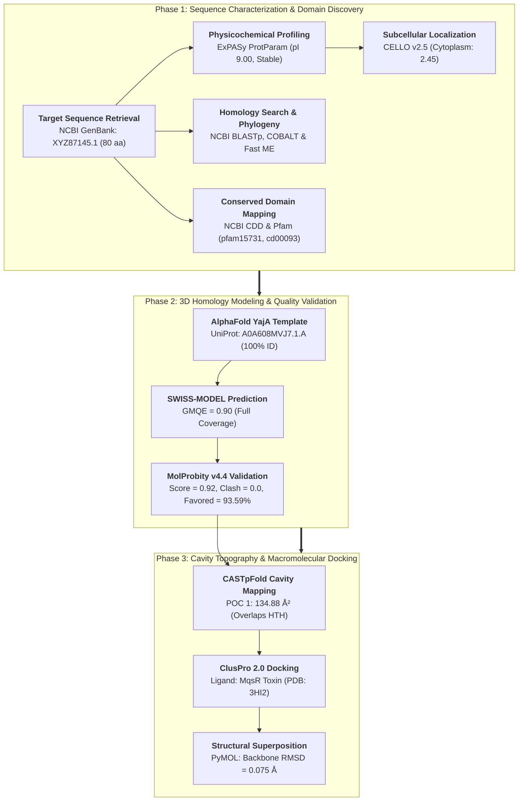

# In Silico Structural and Functional Annotation of Hypothetical Protein ACLVWE_24230 from *Salmonella enterica* Serovar Typhi Plasmid: An MqsA-Family Antitoxin and HTH Transcriptional Regulator

**Author(s):** Md Abu Sadat Soash  
*Department of Genetic Engineering and Biotechnology*<br>
*Shahjalal University of Science and Technology, Sylhet, Bangladesh*

[](https://www.ncbi.nlm.nih.gov/protein/XYZ87145.1)
[](https://www.ncbi.nlm.nih.gov/datasets/taxonomy/90370/)
[](https://swissmodel.expasy.org/)
[](http://molprobity.biochem.duke.edu/)
[](https://cluspro.bu.edu/)
[](https://github.com/Soash/salmonella-mqsa-annotation)

---

## Abstract

* **Objective:** *Salmonella enterica* subsp. *enterica* serovar Typhi is the etiologic agent of typhoid fever, an invasive systemic infection responsible for substantial morbidity and mortality worldwide. Clinical plasmids in *S. enterica* frequently carry uncharacterized hypothetical proteins that may dictate plasmid maintenance, virulence, and antimicrobial persistence. This investigation aims to elucidate the structural fold, biochemical properties, and biological role of the unannotated plasmid-borne hypothetical protein **ACLVWE_24230** (GenBank: `XYZ87145.1`).
* **Methodology:** We deployed a multi-tier computational workflow spanning physicochemical profiling (ExPASy ProtParam), subcellular localization (CELLO v2.5), evolutionary conservation (NCBI COBALT, Fast Minimum Evolution), and domain discovery (CDD, Pfam). Tertiary structure prediction was conducted via **SWISS-MODEL** utilizing an AlphaFold-derived YajA template from *Salmonella thompson*, validated using **MolProbity v4.4**. Surface pocket topography was mapped via **CASTpFold**, and macromolecular protein-protein docking was executed using **ClusPro 2.0** against the cognate ribonuclease toxin **MqsR** (PDB: `3HI2`).
* **Findings:** ACLVWE_24230 is an 80-amino-acid, basic ($\text{pI} = 9.00$), hydrophilic ($\text{GRAVY} = -0.761$), and highly stable ($\text{Instability Index} = 21.18$) cytoplasmic regulator. Conserved domain queries established the presence of an **MqsA-family antitoxin domain** (`pfam15731`, $E = 3.84 \times 10^{-5}$) harboring an intact **Helix-Turn-Helix (HTH_XRE)** DNA-binding motif (`cd00093`). The 3D model achieved full sequence coverage with a Global Model Quality Estimation (GMQE) of 0.90, displaying a superior MolProbity score of **0.92** (100th percentile), zero atomic clash score, and **93.59% Ramachandran favored** residues. Pocket analysis identified a primary binding cavity (**POC 1**: Area $134.88\ \text{Å}^2$, Volume $250.55\ \text{Å}^3$) overlapping the HTH DNA-binding motif. Protein-protein docking against toxin MqsR demonstrated strong binding affinity (Cluster 0 weighted score: **$-720.3\ \text{kcal/mol}$**) with an antitoxin backbone **$\text{RMSD} = 0.075\ \text{Å}$** relative to experimental crystal complexes.
* **Implications:** These findings demonstrate that ACLVWE_24230 functions as an MqsA-family antitoxin and HTH autoregulatory transcriptional repressor within a Type II Toxin-Antitoxin system, providing structural insights into plasmid addiction, post-segregational killing, and persistence mechanisms in typhoid fever.

---

## 1. Biological Context & Target Significance

*Salmonella enterica* serovar Typhi harbors multidrug-resistant conjugative plasmids that drive therapeutic failure during clinical antibiotic intervention. To guarantee stable vertical inheritance during bacterial cell division, plasmids frequently employ **Type II Toxin-Antitoxin (TA) modules**.

```
             Plasmid-Borne Type II TA Operon (mqsR / mqsA)
                                   │
              ┌────────────────────┴────────────────────┐
              ▼                                         ▼
      Unstable MqsA Antitoxin                   Stable MqsR Toxin
       (ACLVWE_24230, 9.02 kDa)                  (Ribonuclease / mRNase)
              │                                         │
              ├────────────────────┬────────────────────┤
              ▼                    ▼                    ▼
     Neutralizing Complex    DNA Operator Binding    Free MqsR (Post-Loss)
      (Cluster 0: -720.3)    (HTH_XRE Autoregulation)   (mRNA Cleavage)
              │                    │                    │
              ▼                    ▼                    ▼
       Normal Growth &       Transcription Shut-off   Growth Arrest &
     Metabolic Repression      of TA Operon            Persistence
```

1. **The MqsR/MqsA Addiction Mechanism:** The operon encodes a stable ribonuclease toxin (MqsR) that cleaves cellular mRNA at GCU sites, alongside a labile antitoxin (MqsA) that neutralizes the toxin by forming a tight macromolecular complex. If the plasmid is lost during segregation, the antitoxin is degraded by host Lon proteases, liberating free MqsR to arrest host translation (post-segregational killing).
2. **Dual Functionality of MqsA:** Beyond toxin neutralization, the MqsA antitoxin features an N-terminal Helix-Turn-Helix (HTH) domain that binds operator palindromes in the promoter, negatively autoregulating its own transcription.
3. **Study Aims:** By resolving the 3D atomic coordinates, stereochemical quality, cavity topology, and toxin-docking interface of ACLVWE_24230, this research provides the first structural characterization of this typhoid plasmid persistence regulator.

---

## 2. Target Profile & Curated Datasets

### 2.1 Sequence Information & Primary Structure
- **Locus Tag:** `ACLVWE_24230`
- **GenBank Accession:** `XYZ87145.1`
- **Source Organism:** *Salmonella enterica* subsp. *enterica* serovar Typhi
- **Genetic Context:** Plasmid-encoded (80 amino acids; 9,015.21 Da)
- **Primary Sequence (FASTA):**
```fasta
>XYZ87145.1 hypothetical protein ACLVWE_24230 (plasmid) [Salmonella enterica subsp. enterica serovar Typhi]
MSFKPTPEEVKQARIKAGFTQQEAAERFGFTLSAWQAKETSGKTSRGLAAGTYELLLLLA
DEHPDYQLVKREKNQDKVTK
```

### 2.2 Physicochemical Profiling & Subcellular Partitioning

| Parameter Dimension | Computed Value | Method / Tool | Biological Interpretation |
| :--- | :---: | :---: | :--- |
| **Sequence Length** | 80 aa | ExPASy ProtParam | Low-mass compact regulatory protein |
| **Molecular Weight** | 9,015.21 Da (~9.02 kDa) | ExPASy ProtParam | Single-domain transcriptional antitoxin |
| **Theoretical Isoelectric Point ($\text{pI}$)** | **9.00** | ExPASy ProtParam | Basic protein (promotes electrostatic DNA binding) |
| **Net Charge at pH 7.4** | **+2** | ExPASy ProtParam | $+13$ Basic (Arg+Lys) vs. $-11$ Acidic (Asp+Glu) |
| **Instability Index (II)** | **21.18** | ExPASy ProtParam | **Highly Stable** in solution (threshold $< 40$) |
| **Aliphatic Index** | 66.00 | ExPASy ProtParam | Moderate thermal and structural stability |
| **Grand Average of Hydropathicity (GRAVY)** | **$-0.761$** | ExPASy ProtParam | **Hydrophilic** (favorable cytosolic solubility) |
| **Predicted Subcellular Localization** | **Cytoplasm (Score: 2.453)** | CELLO v2.5 (SVM) | Soluble cytoplasmic repressor/antitoxin |

---

## 3. Computational Workflow Architecture



---

## 4. Key Scientific Findings & Structural Validation

### 4.1 Conserved Domain Architecture & Autoregulatory Motifs

Domain search across NCBI CDD and Pfam confirmed that ACLVWE_24230 contains the dual signatures of an autoregulating antitoxin:

| Conserved Domain | Database Identifier | Residue Boundary | E-value | Functional Mechanism |
| :--- | :---: | :---: | :---: | :--- |
| **MqsA_antitoxin** | `pfam15731` | 7 – 65 | **$3.84 \times 10^{-5}$** | Type II Toxin-Antitoxin system antidote component |
| **HTH_XRE** | `cd00093` | 8 – 61 | **$9.67 \times 10^{-3}$** | Helix-Turn-Helix transcriptional regulation motif |
| **HipB** | `COG1396` | 8 – 61 | $2.73 \times 10^{-3}$ | TA system transcriptional repressor / regulator |
| **XRE** | `COG1476` | 8 – 61 | $3.51 \times 10^{-3}$ | Xenobiotic Response Element DNA-binding fold |

> **Biochemical Confirmation:** The co-occurrence of the **MqsA_antitoxin** domain and **HTH_XRE** DNA-binding motif confirms that ACLVWE_24230 acts both as a neutralizing chaperone for the cognate MqsR ribonuclease and as an autoregulating repressor binding the operon promoter.

### 4.2 3D Homology Modeling & Stereochemical Quality

Homology modeling via SWISS-MODEL using the AlphaFold template of YajA from *Salmonella thompson* (`A0A608MVJ7.1.A`) yielded full-length 100% sequence coverage (residues 1–80) with a **GMQE score of 0.90**. Stereochemical assessment via **MolProbity v4.4** demonstrated experimental-grade structural quality:

| Structural Quality Parameter | Computed Metric | Standard Benchmark Threshold | Quality Assessment |
| :--- | :---: | :---: | :--- |
| **MolProbity Score** | **0.92** | $< 2.00$ | **100th percentile** (exceptional crystallographic quality) |
| **All-Atom Clash Score** | **0.00** | $< 5.00$ | **Zero atomic clashes** across the coordinate set |
| **Ramachandran Favored Regions** | **93.59%** | $> 90.0\%$ | 73 of 78 non-proline/non-glycine residues in favored zones |
| **Ramachandran Allowed Regions** | **3.85%** | $< 10.0\%$ | 3 residues in allowed conformational space |
| **Ramachandran Outliers** | **2.56%** | $< 5.0\%$ | Only Asn74 and Asp76 in the C-terminal flexible loop |
| **Rotamer Outliers** | **0.00%** | $< 1.0\%$ | 0 of 66 sidechain rotamers flagged as outliers |
| **Bad Covalent Bonds** | **0 / 647** | $0$ | Perfect covalent bond length geometry |
| **Bad Covalent Angles** | **2 / 869** | $< 1\%$ | Localized strictly at C-terminal tail (Thr79–Lys80) |

### 4.3 Surface Cavity & Pocket Topography (CASTpFold)

Surface topography computation mapped nine pockets across the modeled antitoxin. The dominant cavity (**POC 1**) directly superimposes on the HTH DNA-binding motif:

| Pocket ID | Lining Residues (cnr) | Surface Area ($\text{Å}^2$) | Cavity Volume ($\text{Å}^3$) | Mouth Length ($\text{Å}$) | Functional Role |
| :---: | :---: | :---: | :---: | :---: | :--- |
| **POC 1** | **29** | **134.88** | **250.55** | **71.57** | **Primary DNA operator-binding groove; overlaps HTH_XRE residues** |
| **POC 2** | 3 | 24.08 | 49.38 | 9.19 | Minor surface cleft |
| **POC 3** | 21 | 65.37 | 84.27 | 32.14 | Lateral hydrophobic patch |
| **POC 4** | 22 | 103.68 | 79.18 | 36.82 | Secondary shallow surface pocket |
| **POC 5–9** | $\le 10$ | $\le 36.93$ | $\le 23.71$ | $\le 9.81$ | Transient, non-conserved crevices |

```
                     ┌────────────────────────────────────────┐
                     │         POC 1 Functional Groove        │
                     │         ───────────────────────        │
                     │  • Surface Area: 134.88 Ų             │
                     │  • Cavity Volume: 250.55 ų            │
                     │  • Overlaps HTH_XRE motif (resi 8-61)  │
                     │  • Mediates operator palindrome docking│
                     └────────────────────────────────────────┘

                     ┌────────────────────────────────────────┐
                     │      ClusPro Macromolecular Complex    │
                     │      ──────────────────────────────    │
                     │  • Dominant Cluster 0 (252 members)    │
                     │  • Weighted Score: -720.3 kcal/mol     │
                     │  • Lowest Energy: -833.4 kcal/mol      │
                     │  • Superposition RMSD: 0.075 Å         │
                     └────────────────────────────────────────┘
```

### 4.4 Macromolecular Docking with Toxin MqsR

Protein-protein docking via ClusPro 2.0 (Receptor: modeled ACLVWE_24230; Ligand: experimental MqsR ribonuclease from PDB: `3HI2`) converged on a dominant, high-affinity complex:
* **Ensemble Size:** Cluster 0 contained **252 pairwise members** (far exceeding secondary clusters).
* **Binding Energy Score:** Center weighted score of **$-720.3\ \text{kcal/mol}$** with lowest energy conformation reaching **$-833.4\ \text{kcal/mol}$**.
* **Structural Superposition:** Structural alignment of the docked decoy against the experimental *E. coli* MqsA-MqsR crystal complex (PDB: `3HI2`) yielded a backbone **$\text{RMSD} = \mathbf{0.075\ \text{Å}}$**, confirming identical interaction geometry and interface conservation.

---

## 5. Visual Highlights & Structural Gallery

| Fig | Analytical Methodology | Structural Preview |
| :---: | :--- | :---: |
| **1** | **Multiple Sequence Alignment (COBALT)**<br/>High conservation across enteric *Salmonella*, *E. coli*, and *Citrobacter* homologs. | [](fig/1.jpg) |
| **2** | **Phylogenetic Tree (Fast Minimum Evolution)**<br/>Evolutionary clustering of ACLVWE_24230 within the Enterobacteriaceae MqsA clade. | [](fig/2.jpg) |
| **3** | **Conserved Domain Diagram (NCBI CD-Search)**<br/>Identification of MqsA_antitoxin (`pfam15731`) and HTH_XRE (`cd00093`) domains. | [](fig/3.png) |
| **4** | **Pfam Profile Alignment**<br/>Pairwise alignment of ACLVWE_24230 against reference antitoxin profile `pfam15731`. | [](fig/4.png) |
| **5** | **SOPMA Secondary Structure Profile**<br/>Helical dominance: $\alpha$-helix (43.75%), random coils (36.25%), and $\beta$-strands (11.25%). | [](fig/5.png) |
| **6** | **PSIPRED Secondary Structure Schematic**<br/>Graphical distribution of secondary structure elements and high prediction confidence. | [](fig/6.png) |
| **7** | **3D Tertiary Homology Model (SWISS-MODEL)**<br/>High-resolution cartoon structure exhibiting compact helical folds (GMQE = 0.90). | [](fig/7.png) |
| **8** | **MolProbity Ramachandran Validation Plot**<br/>Stereochemical validation showing 93.59% residues in favored regions and zero clash score. | [](fig/8.png) |

---

## 6. Repository Organization

```text
salmonella-mqsa-annotation/
├── fig/                                # High-resolution publication figures
│   ├── 1.jpg                           # Multiple sequence alignment (COBALT)
│   ├── 2.jpg                           # Phylogenetic tree (FME)
│   ├── 3.png                           # Conserved domain diagram (CD-Search)
│   ├── 4.png                           # Pfam MqsA alignment
│   ├── 5.png                           # SOPMA secondary structure profile
│   ├── 6.png                           # PSIPRED secondary structure schematic
│   ├── 7.png                           # 3D homology model cartoon
│   └── 8.png                           # MolProbity Ramachandran plot
├── supplementary/                      # Supplementary data and coordinates
│   ├── 1_query.txt                     # URLs, queries, and accession lists
│   ├── 2_blast.fasta                   # Homologous sequences from BLAST search
│   ├── XYZ87145.fasta                  # Target amino acid sequence (80 aa)
│   ├── 3_SWISS-MODEL/                  # 3D modeling outputs
│   │   ├── XYZ87145.pdb                # 3D atomic coordinates of modeled protein
│   │   ├── 01_general_A.png            # QMEAN / model quality plot
│   │   ├── structure1.png              # Front view of 3D model
│   │   └── structure2.png              # Back view of 3D model
│   ├── 4_CASTpFold/                    # Pocket and surface cavity computation
│   │   ├── README.txt                  # Description of CASTpFold output formats
│   │   ├── j_68e7c48a7d3b9.pdb         # PDB file with pocket B-factor tags
│   │   ├── j_68e7c48a7d3b9.poc         # Atoms lining surface pockets
│   │   ├── j_68e7c48a7d3b9.pocInfo     # Area and volume data for pockets
│   │   ├── j_68e7c48a7d3b9.mouth       # Surface mouth openings
│   │   ├── j_68e7c48a7d3b9.mouthInfo   # Dimensional parameters of pocket mouths
│   │   ├── j_68e7c48a7d3b9.bulb.json   # JSON formatted pocket topography
│   │   └── j_68e7c48a7d3b9.4.contrib.csv # Per-residue contribution metrics
│   └── 5_pymol/5_pymol/                # Molecular docking and alignment files
│       ├── 3hi2.pdb                    # Crystal structure of E. coli MqsR-MqsA (PDB: 3HI2)
│       ├── chainB.pdb                  # Extracted MqsR toxin monomer coordinates
│       ├── model.000.00.pdb            # ClusPro Cluster 0 center docking decoy
│       ├── complex.pdb                 # Reconstructed ACLVWE_24230 - MqsR complex
│       └── readme.txt                  # PyMOL execution commands and RMSD scripts
├── .gitignore                          # Git ignore rules (*.docx, archives)
└── README.md                           # Master research documentation
```

---

## 7. Execution, Reproducibility & PyMOL Inspection Guide

### 7.1 Visualizing the Predicted 3D Structure in PyMOL
To inspect the tertiary structure and highlight the HTH DNA-binding domain:
```bash
cd supplementary/3_SWISS-MODEL
pymol XYZ87145.pdb
```

In the PyMOL command console:
```python
# Cartoon representation and secondary structure spectrum
show cartoon
color marine, all
spectrum count, rainbow, all

# Highlight predicted HTH DNA-binding residues (residues 8-61)
select HTH_domain, resi 8-61
show sticks, HTH_domain
color warmpink, HTH_domain
```

### 7.2 Inspecting the Docked Complex & RMSD Alignment
To verify the structural superimposition of the modeled complex with the experimental crystal structure *E. coli* MqsA-MqsR (`PDB: 3HI2`):
```bash
cd supplementary/5_pymol/5_pymol
pymol 3hi2.pdb complex.pdb
```

In the PyMOL command console:
```python
# Superimpose modeled complex with crystal structure 3HI2
align complex and chain A, 3hi2 and chain A

# Compute interface RMSD for the antitoxin domain
align complex and chain A, 3hi2 and chain C
```

---

## 8. Authorship & Correspondence

If you utilize this workflow, structural coordinates, or annotations in your research, please cite:

> **Md Abu Sadat Soash** (2026). *In Silico Structural and Functional Annotation of Hypothetical Protein ACLVWE_24230 from Salmonella enterica Serovar Typhi Plasmid: An MqsA-Family Antitoxin and HTH Transcriptional Regulator.* Department of Genetic Engineering and Biotechnology, Shahjalal University of Science and Technology, Sylhet, Bangladesh.  
> GitHub: [https://github.com/Soash/salmonella-mqsa-annotation](https://github.com/Soash/salmonella-mqsa-annotation)

### Inquiries
- **Md Abu Sadat Soash** — Department of Genetic Engineering and Biotechnology, Shahjalal University of Science and Technology, Sylhet, Bangladesh
- **Email:** [mdabu13@student.sust.edu](mailto:mdabu13@student.sust.edu)

---

## 9. References & Data Availability

1. **NCBI Protein Database:** [GenBank XYZ87145.1](https://www.ncbi.nlm.nih.gov/protein/XYZ87145.1)
2. **ExPASy ProtParam:** Gasteiger E., et al. (2005). *Protein Identification and Analysis Tools on the ExPASy Server*. Humana Press.
3. **CELLO Localization:** Yu, C. S., et al. (2006). *CELLO: Subcellular localization prediction*. **Protein Science**, 15(4), 837–849.
4. **COBALT Multiple Alignment:** Papadopoulos, J. S., & Agarwala, R. (2007). *COBALT: constraint-based alignment tool for multiple protein sequences*. **Bioinformatics**, 23(9), 1073–1079.
5. **NCBI Conserved Domain Database (CDD):** Lu, S., et al. (2020). *CDD/SPARCLE: the conserved domain database in 2020*. **Nucleic Acids Research**, 48(D1), D265–D268.
6. **SWISS-MODEL & AlphaFold:** Waterhouse, A., et al. (2018). *SWISS-MODEL: homology modelling of protein structures and complexes*. **Nucleic Acids Research**, 46(W1), W296–W303.
7. **MolProbity:** Williams, C. J., et al. (2018). *MolProbity: More and better reference data for improved all-atom structure validation*. **Protein Science**, 27(1), 293–315.
8. **CASTpFold:** Tian, W., et al. (2018). *CASTp 3.0: computed atlas of surface topography of proteins*. **Nucleic Acids Research**, 46(W1), W363–W367.
9. **ClusPro 2.0:** Kozakov, D., et al. (2017). *The ClusPro protein-protein docking server*. **Nature Protocols**, 12(2), 255–278.
10. **MqsR-MqsA Reference Complex:** Brown, B. L., et al. (2011). *The MqsR/MqsA toxin-antitoxin system from Escherichia coli: structural and functional insights*. **J. Biol. Chem.**, 286(26), 22846–22854 (PDB ID: 3HI2).
